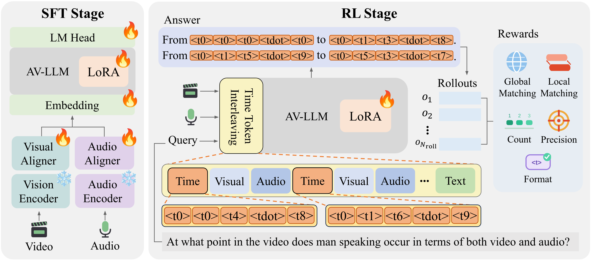

# [ACCV'2026] TiTok: Audio-Visual LLM for Multi-Segment Temporal Grounding

<p align="left">
  <a href="https://arxiv.org/abs/2610.09408">
    
  </a>
</p>

<p align="left">
  Eunji Shin<sup>&#8902;1</sup>, Dahyun Choi<sup>&#8902;1</sup>, Seungyeon Jo<sup>1</sup>, Yejin Hong<sup>1</sup>, Jiyoung Lee<sup>&#8224;1,2</sup>
  <br><br>
  <sup>1</sup>Department of Artificial Intelligence, Ewha Womans University
  <br>
  <sup>2</sup>Division of Artificial Intelligence &amp; Software, Ewha Womans University
</p>

This repository is the official implementation of **TiTok**, an audio-visual LLM that localizes
**every** occurrence of a queried event in an untrimmed video (multi-segment temporal grounding).



TiTok builds on video-SALMONN 2+ (7B). It interleaves time tokens with the audio-visual
stream (**TTI**, time-token interleaving) and is trained in two stages:

1. **SFT** teaches the time-token answer format (`From <t0><t1><t5><tdot><t6> to ...`).
2. **GDPO** optimizes multi-segment rewards (format, count, global, local, precision),
   normalizing each reward channel within its rollout group.

**Contents:** [Installation](#installation) · [Data](#data) · [Training](#training) ·
[Evaluation](#evaluation) · [Results](#results) · [Repository layout](#repository-layout) ·
[License](#license) · [Citation](#citation)

## Installation

Tested on Linux with Python 3.10 and CUDA 12.1 (GDPO on one A100 80GB, SFT on four GPUs).
The pinned versions are those recorded for the paper's GDPO run.

```bash
conda create -n titok python=3.10 -y
conda activate titok
conda install -c conda-forge ffmpeg -y          # audio extraction, torchcodec
pip install torch==2.5.1 torchvision==0.20.1 torchaudio==2.5.1 --index-url https://download.pytorch.org/whl/cu121
pip install -r requirements.txt
pip install flash-attn==2.7.4.post1 --no-build-isolation
# optional
pip install -r requirements-demo.txt            # Gradio demo
pip install -r requirements-dev.txt             # tests
```

Then set the paths:

```bash
cp paths.example.env paths.env                  # edit MEDIA_ROOT (required), CKPT_DIR / OUTPUT_DIR (optional)
```

All launchers source [`scripts/env.sh`](scripts/env.sh), which reads `paths.env`. By default
models go to `checkpoints/` and results to `outputs/` inside the repository. Without a
W&B API key, training logs to W&B offline.

## Data

The annotation files used in the paper are included in [`data/`](data/). Media paths
inside them are relative to `MEDIA_ROOT`.

| File | Stage | Samples |
|---|---|---|
| `data/sft/unav100_sft.json` | SFT | 10,358 (UnAV-100 train) |
| `data/gdpo/train.json` | GDPO | 10,358 (7,207 UnAV-100 + 3,151 Charades-STA) |
| `data/gdpo/val_unav100.json`, `data/gdpo/val_charades.json` | GDPO validation | 100 + 101 |
| `data/test/unav100.json` | test (multi-segment) | 3,455 |
| `data/test/charades_sta.json` | test (single-segment) | 3,719 |

Each entry holds `video`, optional `audio`, `use_audio`, the `conversations` (question and
time-token answer) and, for evaluation data, `gt_label` / `gt_segments` in seconds.

**Videos.** Download the raw videos and place them under `MEDIA_ROOT`:

```
$MEDIA_ROOT/
├── unav_100/
│   ├── videos/<youtube_id>.mp4
│   └── audio/<youtube_id>.wav
└── charades_sta/
    └── Charades_v1/<video_id>.mp4
```

- **UnAV-100** ([project page](https://unav100.github.io/), [GitHub](https://github.com/ttgeng233/UnAV)):
  the project page provides the YouTube IDs and download links for the raw videos.
- **Charades-STA**: videos from the Charades dataset (Allen Institute for AI); sentence
  annotations from [TALL](https://github.com/jiyanggao/TALL). Charades-STA is used without audio.

**Audio.** UnAV-100 samples read a separate `.wav` per video. Extract the audio track with
ffmpeg (the loader resamples to 16 kHz):

```bash
mkdir -p "$MEDIA_ROOT/unav_100/audio"
for v in "$MEDIA_ROOT"/unav_100/videos/*.mp4; do
  ffmpeg -nostdin -loglevel error -i "$v" -vn -ac 1 -ar 16000 "$MEDIA_ROOT/unav_100/audio/$(basename "${v%.mp4}").wav"
done
```

When the loader cannot find a file it prints a warning and skips that sample; if none of
the files exist it stops and asks you to check `MEDIA_ROOT`.

## Training

The pipeline has four steps. Each script is run from the repository root.

**1. Base model with time tokens.** Download
[video-SALMONN2_plus_7B_full](https://huggingface.co/tsinghua-ee/video-SALMONN2_plus_7B_full)
and add the 11 time tokens (`<t0>`–`<t9>`, `<tdot>`):

```bash
source scripts/env.sh
huggingface-cli download tsinghua-ee/video-SALMONN2_plus_7B_full --local-dir $CKPT_DIR/base/video-SALMONN2_plus_7B_full
python tools/add_time_tokens.py \
    --model_path  $CKPT_DIR/base/video-SALMONN2_plus_7B_full \
    --output_path $CKPT_DIR/base/video_salmonn2_plus_7B_time_tokens
```

**2. SFT** (4 GPUs, 1 epoch, LoRA r=16 on q/k/v/o; TTI off). Checkpoints are saved every
250 steps; the paper uses `checkpoint-250`.

```bash
bash sft/scripts/train_sft.sh                    # -> $CKPT_DIR/sft/titok_sft/
```

**3. Merge the SFT LoRA** into the base model:

```bash
python sft/scripts/merge_lora.py --lora_ckpt $CKPT_DIR/sft/titok_sft/checkpoint-250
# -> $CKPT_DIR/base/salmonn2p_7b_unav_v8
```

**4. GDPO** (1x A100 80GB; fresh LoRA r=32 on attention + MLP, TTI on, 8 rollouts per
prompt, clip-higher with mu=2, effective batch 4). The hyperparameters are in
[`gdpo/configs/titok_gdpo.yaml`](gdpo/configs/titok_gdpo.yaml) and the rewards in
[`gdpo/rewards.py`](gdpo/rewards.py). The paper reports `checkpoint-2000`.

```bash
bash gdpo/scripts/train_gdpo.sh                  # -> $CKPT_DIR/gdpo/titok_gdpo/
RESUME=True bash gdpo/scripts/train_gdpo.sh      # resume from the latest checkpoint
```

During GDPO, the validation sets are evaluated at every save step and logged to
`val_metrics.jsonl` in the output directory.

## Evaluation

[`eval/eval.sh`](eval/eval.sh) runs inference and scores the predictions. Inference
settings are in [`eval/config.yaml`](eval/config.yaml) (TTI on, 5 fps).

```bash
# TiTok (GDPO checkpoint on top of the merged SFT model); chunked, resumable
bash eval/eval.sh CHUNK=on STAGE=gdpo CKPT_MODEL_ID=titok_gdpo CKPT_STEP=2000 \
    BASE_MODEL_ID=base/salmonn2p_7b_unav_v8 TESTSET=unav100 GPUS=0
bash eval/eval.sh CHUNK=on STAGE=gdpo CKPT_MODEL_ID=titok_gdpo CKPT_STEP=2000 \
    BASE_MODEL_ID=base/salmonn2p_7b_unav_v8 TESTSET=charades_sta GPUS=0

# the SFT model alone
bash eval/eval.sh MERGED_MODEL=$CKPT_DIR/base/salmonn2p_7b_unav_v8 TEST_JSON=data/test/unav100.json GPUS=0

# re-score existing predictions (no GPU)
bash eval/eval.sh MODE=eval RESULTS=outputs/.../test_results_rank0.json TEST_JSON=data/test/unav100.json
```

Results are written to `outputs/<stage>/<run>/<checkpoint>/fps5_tti/<testset>/`:
`test_results_rank0.json` (predictions) and three summaries that differ only in how IoU is
computed. **`sample_miou_summary.json` is the one reported in the paper.**

- **mIoU**: per-sample IoU between the union of the GT segments and the union of the
  predicted segments, averaged over samples.
- **CountF1**: harmonic mean of (a) chance-corrected count agreement on multi-segment
  queries and (b) the fraction of single-segment queries answered with exactly one segment.

`python eval/maketable.py outputs/gdpo` collects all summaries into one table.

## Results

| Model | UnAV-100 mIoU | UnAV-100 CountF1 | Charades-STA mIoU |
|---|---|---|---|
| SFT only (`salmonn2p_7b_unav_v8`) | 56.8 | 0.16 | – |
| **TiTok** (GDPO, checkpoint-2000) | **65.7** | **0.58** | **56.3** |

Baselines and ablations are reported in the paper. Re-scoring the paper's predictions with
the evaluation code above reproduces these numbers
(`tests/test_eval_regression.py`).

**Model weights:** the TiTok checkpoints will be released on Hugging Face.

## Repository layout

```
TiTok/
├── data/                 annotations (paths relative to MEDIA_ROOT)
├── scripts/env.sh        shared environment for all launchers
├── tools/                add_time_tokens.py
├── sft/                  SFT stage: model/data/training code + scripts/{train_sft.sh, merge_lora.py}
├── titok/                model/data/inference code used by GDPO and evaluation
├── gdpo/                 gdpo_trainer.py, rewards.py, configs/, scripts/train_gdpo.sh
├── eval/                 eval.sh, eval_miou.py, maketable.py, config.yaml
├── demo/                 Gradio demo (app.py, run_demo.sh)
└── tests/                CPU tests (pytest)
```

`sft/` and `titok/` both contain a modified copy of the video-SALMONN 2+ `qwenvl` package.
They are kept separate because the paper's SFT stage was trained with `sft/` and the GDPO
stage and evaluation used `titok/`; the two copies differ in their data, RoPE and trainer
code, so merging them would change one of the two paper pipelines.

**Tests.** `pytest` checks the reward channels against the paper implementation and the
media path handling. Set `TITOK_PRED_UNAV100` / `TITOK_PRED_CHARADES` to prediction files to
also check the paper numbers.

**Demo.** `bash demo/run_demo.sh` starts a local Gradio app with the GDPO checkpoint.

## License

The code is released under the [Apache License 2.0](LICENSE). It is derived from
video-SALMONN 2+ and other projects listed in [NOTICE](NOTICE); their licenses are in
[`third-party-license/`](third-party-license/).

The annotations in `data/` are derived from UnAV-100
([CC BY 4.0](http://creativecommons.org/licenses/by/4.0/)) and Charades-STA. The videos
remain under the terms of their original sources.

## Acknowledgements

TiTok builds on [video-SALMONN 2](https://github.com/bytedance/video-SALMONN-2),
[GDPO](https://github.com/NVlabs/GDPO), [MUSEG](https://arxiv.org/abs/2505.20715) (reward
definitions), [TRL](https://github.com/huggingface/trl), [UnAV-100](https://unav100.github.io/)
and [Charades-STA](https://github.com/jiyanggao/TALL).

## Citation

```bibtex
@inproceedings{shin2026titok,
  title={TiTok: Audio-Visual LLM for Multi-Segment Temporal Grounding},
  author={Shin, Eunji and Choi, Dahyun and Jo, Seungyeon and Hong, Yejin and Lee, Jiyoung},
  booktitle={Proceedings of the Asian Conference on Computer Vision (ACCV)},
  year={2026}
}
```
